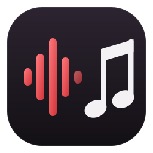
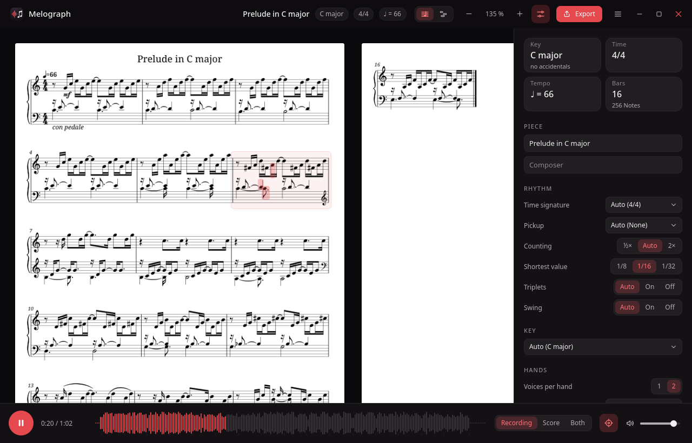
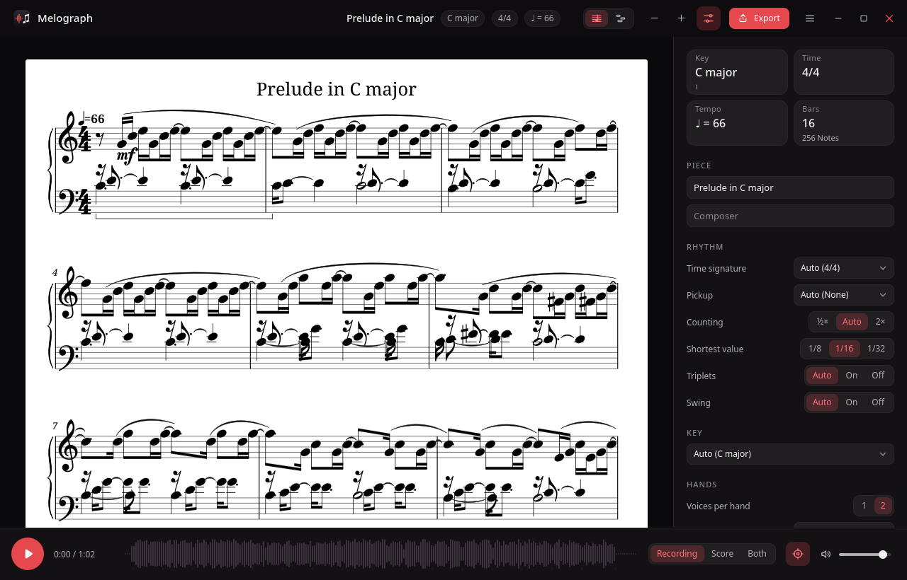
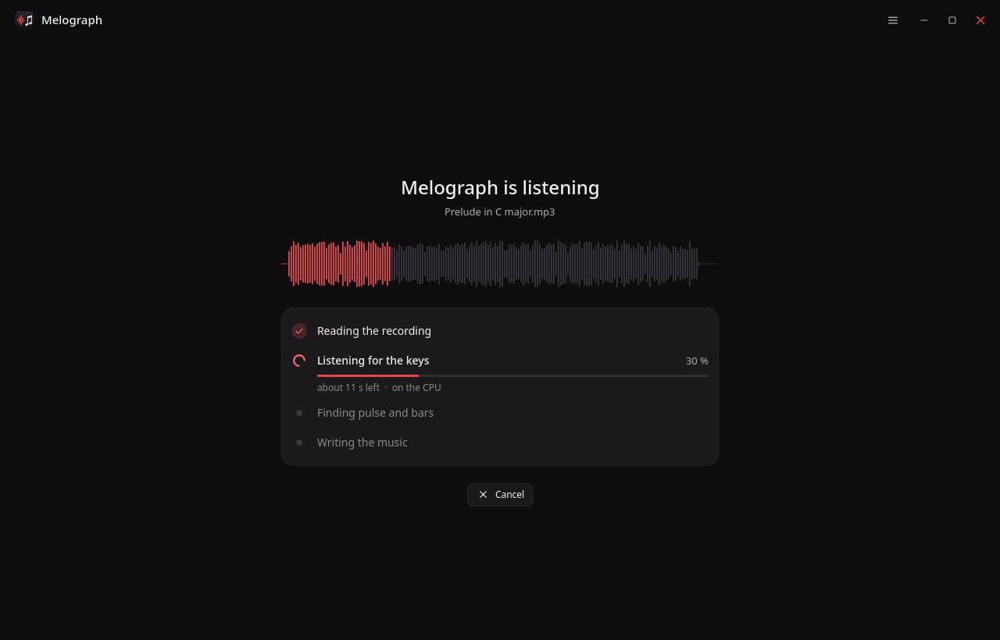
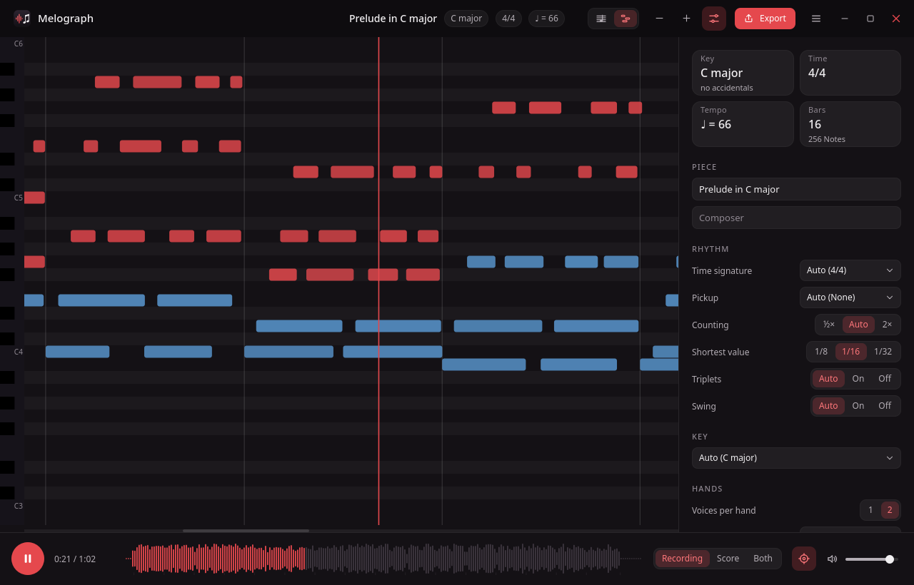
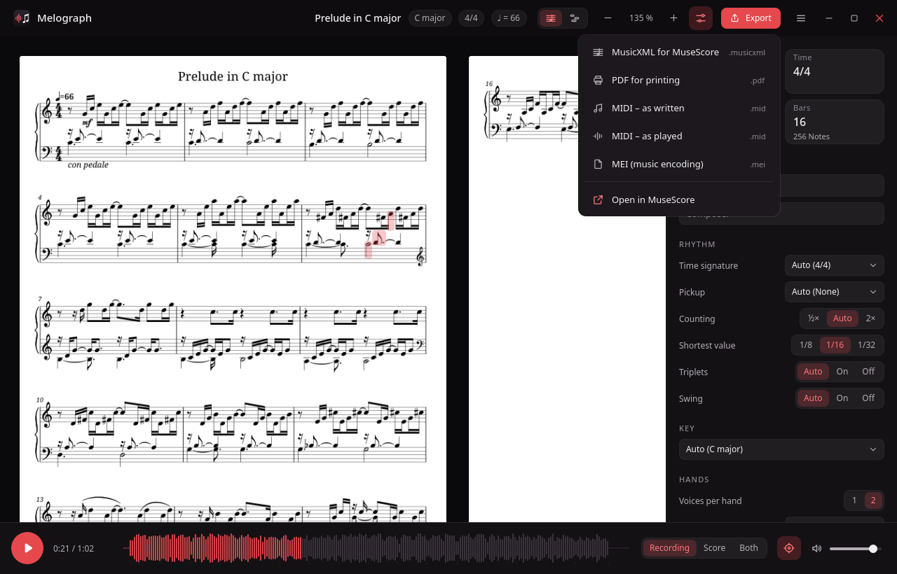
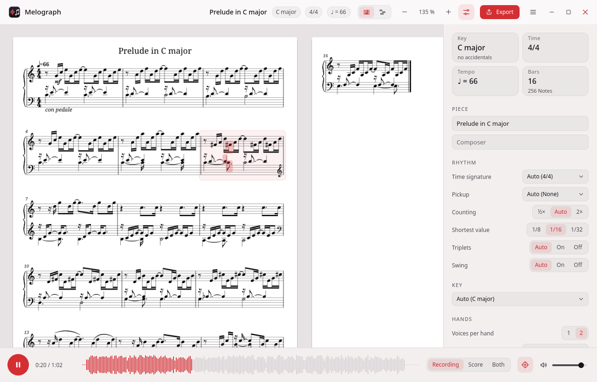

<p align="center">
  
</p>

<h1 align="center">Melograph</h1>

<p align="center"><b>Piano recordings become sheet music.</b><br>
Drop in a recording of someone playing the piano and get engraved notation for both hands,<br>
ready for MuseScore, as PDF or as MIDI. Everything runs on your own computer.</p>

<p align="center">
  <a href="https://github.com/DevEmperor/Melograph/releases/latest"></a>
  <a href="LICENSE"></a>
  
</p>

<p align="center">
  
</p>

There are good tools that turn piano audio into MIDI, and good programs for
writing scores – but a MIDI file is not sheet music. Melograph does the part in
between: it decides on bars, rhythm, hands, voices, key and markings the way an
engraver would, so that what opens in MuseScore is something you can read and play.

The name comes from the 18th-century *melograph*, a device built onto a keyboard
that wrote down whatever was played on it.

## Download

**[Melograph for Linux (AppImage)](https://github.com/DevEmperor/Melograph/releases/latest)**:
one file of about 490 MB with everything inside, for any 64-bit PC with a
distribution from the last few years (glibc 2.34 or newer: Ubuntu 22.04, Debian 12,
Fedora 35, Linux Mint 21, Arch, Manjaro and later).

```bash
chmod +x Melograph-*-x86_64.AppImage
./Melograph-*-x86_64.AppImage
```

Or make it executable in the file manager (*Properties → Permissions*) and
double-click it. In Melograph's preferences, **In the application menu** adds it
to the menu of your desktop with one switch.

The AppImage needs no internet connection, not even on the first start: both
recognition models are inside. Nice to have, but optional:

- **FluidSynth** and a piano SoundFont (MuseScore brings one), for a real piano
  sound when you listen to the written notes. Without it Melograph plays a simple
  tone of its own.
- **MuseScore 4**, to open the score with one click.

Updates: the AppImage carries update information, so
[Gear Lever](https://flathub.org/apps/it.mijorus.gearlever) or
[AppImageUpdate](https://github.com/AppImageCommunity/AppImageUpdate) fetch only what changed.

## What it does

Melograph listens to a recording, hears every key that was pressed, finds the
pulse and the bars, and writes the music the way an engraver would:

- **Notes for two hands** on a grand staff, with a second voice wherever a key is
  held while the hand plays on – and nowhere else.
- **Rhythm** that reads well: each beat gets its own subdivision (eighths,
  sixteenths, triplets, quarter-note triplets), chosen for the whole piece
  together, so one late note does not turn a bar into a triplet – and for each
  hand by itself, so a triplet over plain eighths is three against two. Ties and
  rests follow engraving rules; simple syncopations and dotted figures stay one note.
- **Time signature and pickup**, including compound meters (6/8, 9/8, 12/8) –
  and **changes of metre**: a section in 12/8 inside a piece in 4/4, a single
  bar of 3/4.
- **Key signature** and spelling (G♯ or A♭?) from the line of fifths and where a
  note resolves – with a **new signature where the music modulates**, announced
  by a double bar line.
- **Tempo** for every section: a new metronome mark where the music settles on
  another tempo, *rit.* / *a tempo*, and a fermata where it pauses. The pulse
  stays on one counting level throughout (♩ = 80 does not turn into ♪ = 160 in
  the fast part).
- **Pedal** marks where the sustain pedal went down and was changed – or just
  *con pedale* when it is down all the way through, as printed music has it.
- **Slurs** over passages that were played legato with the fingers.
- **Dynamics and hairpins** from how hard the keys were struck; **accents** on
  the few notes that stand out.
- **Staccato**, **grace notes**, **trills**, **rolled chords**.
- **8va / 8vb lines** for passages far off the staff, **clef changes** when a hand
  moves into the other register.
- **Swing** detected and written as straight eighths with a "Swing" mark.
- **Chord symbols** above the staff, if you like (off by default).

And around that:

- A **live score view** with the pages side by side, as in MuseScore: the notes
  that sound light up while the recording plays, the view turns the pages along,
  and a click on a bar jumps there. Zoom with Ctrl + mouse wheel, a pinch on the
  touchpad, or the percentage in the header.
- Listen to **the recording, the written notes, or both at once** in sync – the
  quickest way to hear where the transcription is wrong.
- A **piano roll** of what was heard.
- **Every decision can be overridden** – time signature, pickup, counting level,
  key, shortest note value, triplets, swing, voices, hand split, every kind of
  marking – and the music is rewritten in about a second.
- **Export** MusicXML (for MuseScore, Dorico, Sibelius, Finale …), PDF, MIDI as
  written, MIDI as played, MEI – or open it in MuseScore directly.
- **Record** straight from a microphone.
- Opens **MP3, WAV, FLAC, M4A, OGG, Opus, video files and MIDI**.
- Recent pieces with previews; what was heard once is remembered, so changing
  the notation never means waiting for the transcription again.
- German and English, dark and light, following the desktop.
- A **command line** for batch work.

| | |
|---|---|
|  |  |
|  |  |

<p align="center">
  
</p>

## Use

**Window:** start Melograph and drop a recording on it, open one with Ctrl+O, or
record with Ctrl+R. The first transcription of a piece takes about a quarter of
its length on a laptop CPU (a three-minute piece: under a minute); afterwards it
opens instantly.

| Key | | Key | |
|---|---|---|---|
| Space | play / pause | Ctrl+E | export … |
| ← / → | five seconds back / on | Ctrl+S | save MusicXML |
| Home | to the beginning | Ctrl+M | open in MuseScore |
| Mouse wheel | turn the pages | F9 | show / hide the settings |
| Ctrl + wheel, pinch, Ctrl+± | zoom | Ctrl+, | preferences |
| Ctrl+0 | whole pages again | Ctrl+O, Ctrl+R | open, record |

**Command line:** with files, the AppImage (and `melograph.sh`) works without a window.

```bash
./Melograph.AppImage recording.mp3                    # → recording.musicxml + recording.mid
./Melograph.AppImage *.mp3 -o scores/ --pdf           # several at once, with PDFs
./Melograph.AppImage waltz.flac --time 3/4 --key Eb   # force what the detection got wrong
./Melograph.AppImage song.m4a --chords --swing on     # lead-sheet style
./Melograph.AppImage --help                           # everything else
```

## How it works

1. **Hearing the keys** – [Transkun](https://github.com/Yujia-Yan/Transkun)
   (Yan & Duan, ISMIR 2024), a transformer with a neural semi-CRF, gives onset,
   release, loudness and pedal of every note. A much softer octave or twelfth
   that only rings along with a note is taken out again; octaves that were
   played stay.
2. **Pulse and bars** – [Beat This!](https://github.com/CPJKU/beat_this)
   (Foscarin, Schlüter & Widmer, ISMIR 2024) says fifty times a second how
   likely a beat and a downbeat are. Melograph reads these probabilities
   together with the notes instead of taking a finished list of beats: first a
   tempo curve that follows real changes of tempo but stays on one counting
   level, then the beats along it, then the bar lines one bar at a time – so
   that a change of metre or a fermata does not push everything after it off
   the beat. A pause is one long beat, and bars that a ritardando has pulled
   out of shape are counted again (`melograph/beats.py`).
3. **Rhythm** – a dynamic programme picks the subdivision of every beat for the
   whole piece; grace notes, trills and rolled chords are recognised first, so
   they do not end up as clouds of 32nd notes. Stretches whose beats fall into
   three become compound time. Once the hands are known, each gets its own
   subdivision: a triplet over plain eighths is written as three against two,
   and a figure that comes back is written the same way each time.
4. **Hands** – every chord is cut at some pitch; a beam search over the piece
   decides where, by what two real hands do: stretch, travel, time to travel,
   keys still held, hands not crossing – and habit: a hand plays again the keys
   it has just played and keeps the rhythm it has been playing, which keeps
   an accompaniment in the left hand when it climbs into the tune's register
   and a figure in the right hand when it dips into the accompaniment's.
5. **Lengths and voices** – a note lasts until the next one in the same hand; a
   rest stands where the sound really stops or a detached note leaves a gap; a
   tie over a beat or a bar line only where the key stays down; a second voice
   only where holding keys is the texture of the music.
6. **Keys** – the signature that leaves the fewest foreign notes and sounds
   like the music, for every stretch of bars (`melograph/spelling.py`).
7. **Markings** – pedal, slurs, dynamics, hairpins, accents, fermatas, tempo,
   octave lines, clefs, chord symbols (`melograph/marks.py`).
8. **Engraving** – bars, ties and tuplets by the rules of the trade, written as
   MusicXML through [music21](https://github.com/cuthbertLab/music21); the
   preview and the PDF are engraved by [Verovio](https://www.verovio.org).

## Limits

- Best with **solo piano** in a decent recording. Voices or other instruments
  turn into wrong notes.
- Changes of metre and key are found where the music makes them clear. In very
  free **rubato** a bar can come out a beat short or long, a few bars in
  another metre can have their bar lines a beat off, and music without a felt
  pulse gives restless rhythms – `--grid 8` or `--triplets off` help, and a
  time signature or key you set yourself holds for the whole piece.
- In chromatic music the **key signature** of a passage can differ from what
  an editor would choose; the notes are the same, with more accidentals.
- A rhythm between two readings is written as it was played, unless the same
  figure is clear elsewhere in the piece.
- The hand split follows what is comfortable to play, not always what a
  composer wrote; dense **broken-chord textures** sometimes give a note to the
  wrong hand. Fingerings, repeats and lyrics are not written.

The result is a very good first draft to correct in MuseScore – not a
replacement for doing so.

## Privacy

Melograph works entirely on your computer; no recording ever leaves it, and the
AppImage never goes online. Run from source, it downloads the Beat This! model
(78 MB) once from the Johannes Kepler University on the first transcription.

What Melograph keeps: settings in `~/.config/melograph`, the list of recent
pieces in `~/.local/share/melograph`, and what it heard in `~/.cache/melograph`
(a few hundred kB per piece; *Preferences → Cache → Clear* empties it).

## Run from source

You need Python 3.10 or newer; `ffmpeg` is used if it is there (without it,
MP3, WAV, FLAC and Ogg Vorbis still open).

```bash
git clone https://github.com/DevEmperor/Melograph.git
cd Melograph
./melograph.sh
```

The first start sets up its own environment in `.venv` (a few minutes, about
1.8 GB – PyTorch is installed without CUDA, which is plenty fast).
`tools/install-desktop.sh` adds Melograph to the application menu and a
`melograph` command to `~/.local/bin`. A CUDA build of PyTorch is used
automatically if you install one into `.venv` yourself; Melograph then
transcribes on the GPU when it has room.

## Development

```bash
.venv/bin/python -m pip install -e ".[dev]"
.venv/bin/python -m pytest                          # notation tests with pieces of known score
.venv/bin/python tools/demo.py demo.wav             # Bach's Prelude in C, synthesized (public domain)
.venv/bin/python tools/screenshots.py demo.wav out  # pictures of every view, offscreen and silent
packaging/appimage/build.sh                         # → dist/Melograph-<version>-x86_64.AppImage
```

```
melograph/
  transcribe.py  Transkun, MIDI in/out          beats.py      pulse, bars, metre
  ornaments.py   trills, rolled chords          quantize.py   rhythm, grace notes, swing
  hands.py       which hand plays what          voices.py     note lengths, voices, staccato
  spelling.py    key, enharmonic spelling       marks.py      pedal, slurs, dynamics, tempo, chords …
  engrave.py     bars, ties, tuplets            export.py     MusicXML
  render.py      Verovio pages for Qt           synth.py      sound of the written notes
  pipeline.py    all of it, without interface   cli.py        command line
  gui/           the window (PySide6 + QML), engine process, playback, recording
packaging/appimage/   build script, start script and pinned versions of the AppImage
```

## Credits and licences

Melograph is free software under the **GNU GPL 3.0 or later** (see [LICENSE](LICENSE)).
It stands on the shoulders of:

| Component | Licence |
|---|---|
| [Transkun](https://github.com/Yujia-Yan/Transkun) – piano transcription | MIT |
| [Beat This!](https://github.com/CPJKU/beat_this) – beat and downbeat tracking | MIT |
| [music21](https://github.com/cuthbertLab/music21) – MusicXML | BSD-3-Clause |
| [Verovio](https://github.com/rism-digital/verovio) – engraving | LGPL-3.0 |
| Leland and Leipzig music fonts (via Verovio) | SIL OFL 1.1 |
| [PySide6 / Qt](https://www.qt.io/qt-for-python) – interface | LGPL-3.0 |
| [PyTorch](https://pytorch.org) | BSD-3-Clause |
| [PyAV](https://github.com/PyAV-Org/PyAV) / FFmpeg – opening audio files | BSD-3-Clause / GPL-3.0 |
| [miniaudio](https://github.com/irmen/pyminiaudio) – sound in and out | MIT |
| [Rich](https://github.com/Textualize/rich) – command line | MIT |

Everything the AppImage contains is listed in [THIRD-PARTY.md](THIRD-PARTY.md).

Contact: contact@devemperor.net
